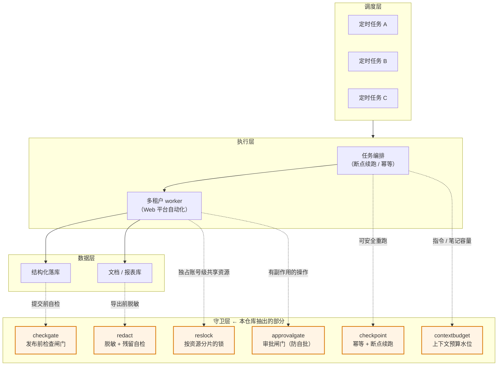
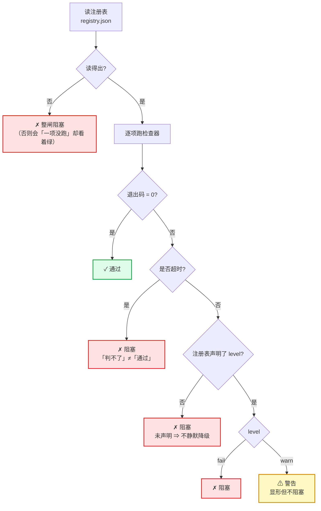
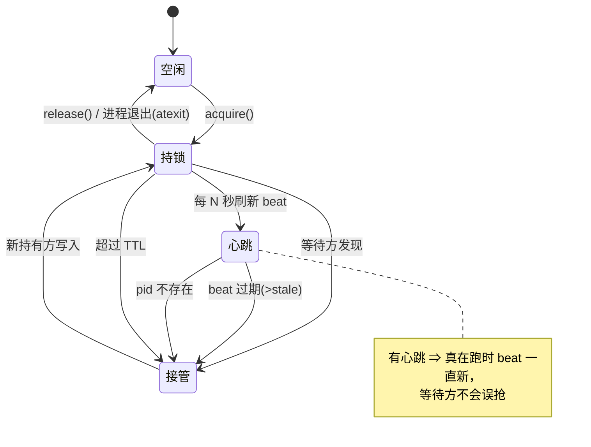

# 架构（泛化）

> 这份图描述的是**抽取来源的那套生产系统**，已做泛化处理：不含任何客户、平台或业务细节。
> 重点是**结构**，不是具体做什么。

---

## 本页速览

- **整体分层**：调度 → 执行 → 守卫 → 数据；**守卫层**就是本仓库抽出的部分
- **检查闸门的判定流**：三条硬规则 —— 判不了 / 未声明 / 读不出 ⇒ **一律阻塞**
- **锁的状态迁移**：三个判据（pid 死 / 心跳过期 / 超 TTL）各自挡什么
- **五层各自的静默失败与守卫**（末尾一张表）

> 这篇只画结构；**完整的设计逻辑**（职责边界、任务生命周期、边界与扩展点）
> 见 [`system-design.md`](system-design.md)。

---

## 一、整体分层

**要点**：守卫层不参与业务，只回答「**这一步出去之后，会不会把不该出去的东西带出去 / 会不会骗自己**」。

---

## 二、`checkgate`：fail-closed 的判定流

**三条硬规则**：判不了 ⇒ 阻塞；未声明 ⇒ 阻塞；注册表读不出 ⇒ 阻塞。
一句话：**「没跑成」永远不许冒充「跑通了」。**

---

## 三、`reslock`：一把锁的状态迁移

**为什么三个判据而不是一个**：

| 判据 | 挡住的坏情况 |
|---|---|
| pid 不存在 | 持有进程崩了 |
| `beat` 过期 | 进程还活着但**早已不干活**（会话复用 / 进程池） |
| 超 TTL | 兜底，防 pid 被无关进程复用 |

---

## 四、五层各自的「静默失败」与守卫

| 层 | 可能怎么静默失败 | 守卫 |
|---|---|---|
| 调度 | 任务没跑，却以为跑了 | 完成心跳 / 结果落库校验 |
| 编排 | **重跑**重复副作用；跳步时用了过时输入 | `checkpoint`（输入指纹） |
| 执行 | 抢了别人的资源 / 被抢 | `reslock` 分片锁 |
| 守卫 | 自检没跑却报通过；脱敏漏一处；笔记超限被截断；危险操作被**静默放行** | `checkgate` / `redact` / `contextbudget` / `approvalgate` |
| 数据 | 导出物里带真值 | `redact` 的 fail-closed 自检 |
