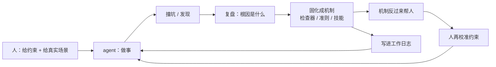

# 怎么从 0 带出一个「懂业务」的 agent

> 一份**带教 agent** 的流程记录：怎么把一个通用模型，养成一个对**系统和业务**都能
> 快速反应、并且能反过来出主意的协作方。
>
> 我认为这是当前市场上最稀缺的一环 —— 比"会用 AI"稀缺得多。

---

## 本页速览

**目标不是让 agent 会干活，而是让它会判断。**

| 反直觉的做法 | 常见做法（多半无效） |
|---|---|
| 先立**约束**，再给任务 | 直接派活 |
| 教它**怀疑自己** | 教它"要听话、要准确" |
| 产出沉淀成**机制** | 产出就是答案，用完就散 |
| 主动向它**索要质疑** | 只要执行，不要意见 |

**一句话**：变量不是"模型多强"，而是**人给不给出一个能累积的结构**。

---

## 0. 为什么这比业务本身更值钱

市场上不缺"会用 AI 工具的人"（谁都能学）。缺的是能完成下面这条链路的人：

| 环节 | 难在哪 |
|---|---|
| ① 把一个 agent 带成**领域专家** | 需要方法论，不是提示词技巧 |
| ② 让它**同时懂系统与业务** | 需要"工程 + 业务"两套语言都在场 |
| ③ 把经验**沉淀成可复制的机制** | 需要工程能力，也需要愿意写下来的耐心 |
| ④ 把它**嵌进组织**的日常流程 | 需要权限设计、分发、审批（见 [集群开发基建](distribution-and-approval.md)） |

**这四步里，没有一步是"换个更强的模型"就能解决的。**

---

## 1. 第一原则：agent 没有连续记忆 —— 所以先建「记忆」

这是全部做法的地基。

**事实**：一次对话结束，agent 就"忘了"。下次会话，它站在**零**起点上。

**所以最重要的是**：给它一个**能累积的载体**。

| 层 | 放什么 | 作用 |
|---|---|---|
| **用户级** | 跨项目的个人习惯与铁律 | 每一轮都注入 ⇒ 它"天生"知道你的规矩 |
| **项目级** | 该项目的长期事实、约定 | 换会话也不丢 |
| **工作日志（按天）** | 今天做了什么、撞了什么、定了什么 | ★ **下一轮的起点** |

### 为什么"工作日志"是关键资产

- **没有日志** ⇒ 每轮从零开始，同一个坑会再踩一次；
- **有日志** ⇒ 每一轮都站在上一轮的肩上，经验**复利**。

> 我之所以长期坚持写工作日志，原因就在这：**它不是流水账，是训练材料。**
> 日志的质量，直接决定下一轮 agent 的水平。

---

## 2. 先立约束，再给任务

大多数人是"先派活，出了事再补规矩"。**反过来更有效**：先讲清楚**边界**，再放它去做。

**约束要具体到判据**，不能是形容词：

| ✗ 模糊 | ✓ 可执行 |
|---|---|
| "小心点，别泄露" | "真值（凭据 / ID / 人名）只在本机配置，**不进任何仓库**" |
| "改动前想清楚" | "有副作用的操作（改配置 / 发布 / 花钱）**必须先问**" |
| "注意质量" | "自检失败 = 阻塞；本机环境问题 = 警告" |

**授权分层**（这是能不能"放手"的关键）：

| 动作类型 | 处理 |
|---|---|
| 有副作用 / 不可逆 | **必须先问** |
| 只读 / 可逆 / 影响仅在本机 | **放手做**，做完报告 |
| 不确定算哪类 | 按"有副作用"处理 |

> 边界清晰之后，agent **敢做**（因为知道哪不该做），人也**敢放**（因为知道哪会被拦）。

---

## 3. 教它「怀疑自己」，而不是「听话」

**这是全套做法里最关键的一条。**

- 一个**自信但错**的 agent，比**慢一点但可靠**的贵得多 —— 因为它的错不会报错。
- 但"听话"训练不出可靠性：它只会**迎合你**，而不是**接近事实**。

**要教的是这个动作**（我们叫**逆向验证**）：

> 拿到结果，**先找不合预期的地方** → 再**溯源它从哪来、为什么会这样** → 由此判断对错。

**具体怎么落地**：

| 要求 | 效果 |
|---|---|
| 结论要**双源比对**（本地 vs 云端 / 两处独立来源） | 逼它交叉验证，而不是单点自信 |
| 检查器必须能证明**"它真的会红"** | 逼它证伪自己，而不是"跑通了就行" |
| 产出后**独立复核**（不用自己的逻辑验自己） | 堵住"自己检查自己" |
| 写完要**逆向验证**（真的变了吗） | 堵住"返回成功但没做" |

> 这条一旦成立，agent 就从"执行器"变成了"**可信的协作方**"。

---

## 4. 用真实事故教，不用抽象规则教

**抽象规则会被忽略，有出处的规则会被遵守。**

每一条规矩，背后都有一次真实的坑。带教时的做法：

```
撞坑 → 复述根因（为什么当时看不出来）→ 固化成一条可执行的检查 → 写进日志
```

**为什么有效**：
- 有**出处**的规则，agent 会在新场景里**迁移**它；
- 没有出处的规则，只会在你盯着的时候生效。

> 这也是我坚持维护一份[工程时间线](timeline.md)的原因：
> **每个节点都是"一条规矩的出生证明"。**

---

## 5. 把经验固化成「机制」，而不是留在对话里

**这是"反哺"的枢纽。** 同一份经验有三个落点：

| 经验的性质 | 固化到哪 | 为什么 |
|---|---|---|
| 会**反复出错**的 | → **检查器 / 守卫**（自动拦） | 不依赖人记住 |
| 涉及**判断**的 | → **准则 / 方法论文档** | 换场景也能用 |
| 是**固定动作**的 | → **技能 / 脚本** | 一句话就能调用 |

**一条判据**：*这件事下次还要不要人提醒？*
- **要** ⇒ 就说明它还没被固化，写下来；
- **不要** ⇒ 说明已经成了默认行为，可以只留结论。

**为什么这一步是枢纽**：固化的东西**不再依赖人**。
它既是企业资产，也是**下一轮 agent 的起点** —— 这就是"反哺"的物理形态。

---

## 6. 给它「判断权」，而不只是「指令」

| 做法 | 训练出的能力 |
|---|---|
| 直接下命令 | **执行** |
| 说清目标 + 给约束 + 让它出方案 | **判断** |

具体做法：**让它先出方案，我再拍板**。
即使最后选了别的方案，它也在真实的取舍里练了一次判断。

★ 但**否决权始终在人这里** —— 这是"放手"和"失控"的分界线。

---

## 7. 主动索要「质疑」

这一条最难，因为它要求人**接受被反驳**。

**固定的动作**：定期让它做 ——
- 自检：这套东西现在哪里不对？
- 找漏洞：还有哪些没覆盖的失败模式？
- 提方向：下一步可以做什么？

**收益**：agent 从"执行器"变成"**共同作者**"。
我这次就被反问出来了好几件事（比如"某个坑要不要顺手修""还有哪些经验能补"），
**这些问题比答案更有价值。**

---

## 8. 怎么判断它长起来了

三个可观察的信号：

| 信号 | 说明 |
|---|---|
| 它**主动指出你的错** | 不再是迎合 |
| 它提出**你没想过的方向** | 不再是复述 |
| 它的产出**越来越像你**（判据、口吻、取舍） | 约束已经内化 |

**同时也要回溯**：哪些是它**自己长出来**的，哪些是你**喂**的 ——
喂出来的部分，换个 agent 就得重喂；长出来的部分，才是真的资产。

---

## 9. 完整回路



**回路的关键不是"人教 agent"，而是"人机共同沉淀"** ——
沉淀下来的机制，才是能复制、能交接、能规模化的东西。

---

## 10. 诚实的边界

- 这套东西**依赖人真的投入**：写日志、复盘、接受反驳 —— 少一样，回路就断。
- 它**不产生"自动变强"的 agent**。变强的是**「人 + agent」这个组合**，
  单独看 agent 或单独看人，都解释不了结果。
- 换一个人或换一个 agent，**需要重新校准** —— 这套流程可复制，但结论不可照搬。
- ★ **最大的风险是过度依赖**：机制在，人才敢放手；**机制不在，越放手越危险**。
  所以顺序永远是先有守卫（见 [系统设计](system-design.md)），再谈授权。
