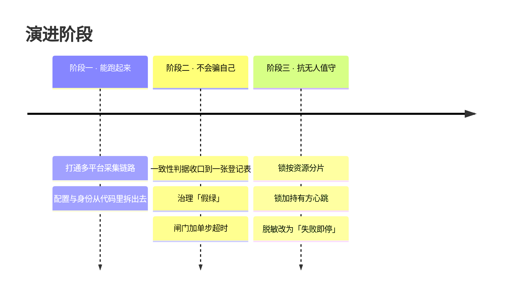

# 工程时间线

> 这套系统从「能跑」到「无人值守可托管」的过程。
> **只列工程节点**：每个节点写清「遇到什么问题、怎么解、学到什么」，不含任何业务细节。
>
> 完整工作记录另有脱敏存档（含逐日细节），面试时可提供。

---

## 本页速览

| 阶段 | 主题 | 代表节点 |
|---|---|---|
| **一 · 能跑起来** | 打通链路、配置与身份外置 | 断点续跑、身份判据、提交前自查 |
| **二 · 不会骗自己** | 判据收口到一处、治理「假绿」 | 登记表驱动、警告要显形、单步超时 |
| **三 · 抗无人值守** | 并发与数据安全 | 分片锁、心跳、脱敏失败即停 |

下面 12 个节点逐条写「遇到什么问题 / 怎么解 / 学到什么」。

---

## 三个阶段

---

## 节点明细

| # | 阶段 | 遇到的问题 | 怎么解 | 学到什么 |
|---|---|---|---|---|
| 1 | 一 | 采集流程跑一次能成，**再跑一次就乱**（重复执行、状态残留） | 拆成可记录进度的若干步（编排）＋ **断电可续**（记住做到哪）＋ **重跑无副作用**（幂等） | 「跑通一次」和「能反复跑」是两件事 |
| 2 | 一 | 敏感配置与代码混在一起，改个配置要动代码 | 配置拆到独立文件；身份**改为看平台上的既成事实**，而不是看自己填的标记 | 判断依据不该用「自己能随便改的东西」 |
| 3 | 一 | 本机绝对路径、个人身份、真实业务值，可能被顺手带进仓库 | 提交前自动扫描三类东西：占位符有没有漏替、远端地址、绝对路径 | **提交前自查**比事后清理便宜一个数量级 |
| 4 | 二 | 同一条判据**写在两个地方**，改一处漏一处 ⇒ 检查悄悄少跑一项 | 收口到**一处**（一张 JSON 登记表）；加一项检查只改这一处 | 同一个判断有两份，就一定会漂移，而且是**静默**漂移 |
| 5 | 二 | 程序退出码是 0，就被当成「全绿」；真实缺陷**以"可以推送"的形式蒙混过关** | 判定行不再无条件打 ✅，把**警告条数**摆到眼前 | 「没有阻塞项」≠「没有问题」 |
| 6 | 二 | 判据从写死在代码里，改成放在配置表里之后，**原来"检查根本不会挂"的隐含保护没了** | 给每次调用加单步超时；**超时 = 阻塞** | 抽象化会顺手移除隐含保护，要**显式补回来** |
| 7 | 二 | 检查器「没跑成」有可能被当成「跑通了」 | 三种情况**一律阻塞**：判断不了 / 没声明严重级别 / 登记表读不出 | 「判不了」必须和「不通过」同等待遇 |
| 8 | 三 | 不相干的任务，被同一把全局锁逼着排队 | 先盘点**实际共享**的资源，锁**按资源分片** | 锁的粒度该由**资源**决定，不是由「任务」决定 |
| 9 | 三 | 任务早就做完了、进程还留着 ⇒ 锁被白白占着，直到**超时阈值**耗尽 | 持锁方定期**打卡**；等待方看到打卡过期，即可接管 | 「进程活着」≠「在干活」 |
| 10 | 三 | 脱敏只替换一次，漏了一处却看起来干净 | 替换后**独立再扫一遍**，有残留就拒绝产出 | **验证必须独立于被测对象** —— 自己检查自己等于没检查 |
| 11 | 三 | 词典只覆盖「已知的」真实业务值（客户编号、公司名这类），文档却可能引用**别的**同类值 | 补一条兜底规则：**数字形态 + 上下文关键词**同时命中 ⇒ 一样替换 | 靠枚举的防护一定有缺口，要留兜底 |
| 12 | 三 | 单机上的锁，在多机环境里失效 | （进行中）评估带超时的分布式租约 —— 让多台机器之间也能安全抢锁 | 单机上的做法，不要硬撑分布式场景 |

---

## 一个具体的教训（值得单独记）

抽离代码时踩到的**跨平台坑**。

**要解决的事**：怎么判断某个进程是不是还活着 —— 用来回收被僵尸进程占住的锁。

| | 写法 | 结果 |
|---|---|---|
| **原实现**（Node） | `process.kill(pid, 0)` | ✅ **安全** —— 传 `0` 表示「只探测存不存在，**不发信号**」 |
| **照搬到 Python** | `os.kill(pid, 0)` | ❌ **在 Windows 上，会把那个进程真的杀掉** |

原因：Python 的 `os.kill` 只对 `CTRL_*`（Ctrl+C 那一类控制信号）有特殊语义，
**其余的值 —— 包括 `0` —— 一律走「强制终止」这条路径**。

**结论**：跨语言移植时，**同名的 API ≠ 同义的 API**。安全相关的调用必须逐条查文档。

> 这就是 `reslock` 里那个「判断进程死没死」的函数（`pid_alive`）为什么绕开 `os.kill`，
> 改用 Windows 的 `OpenProcess` + `GetExitCodeProcess` ——
> 这两个系统接口**只查询状态，不发任何信号**，所以绝对不会误杀。

---

## 每条工程判断的落点

上表那些判断，没有停在文档里，都落成了**可执行的检查或库**：

| 判断 | 落点 |
|---|---|
| 提交前自查 | 通用化扫描 + [`checkgate`](../failclosed/checkgate.py)（**发布前的检查闸门**） |
| 判据只写一处 | 登记表驱动的闸门 —— 加一项检查只改登记表 |
| 「判不了」≠「通过」 | [`checkgate`](../failclosed/checkgate.py) 的四条 fail-closed 规则 |
| 验证独立于被测对象 | [`redact.residual`](../failclosed/redact.py)（**脱敏后独立再扫一遍**的那个函数） |
| 「进程活着」≠「在干活」 | [`reslock`](../failclosed/reslock.py) 的**持锁方打卡**（心跳） |
