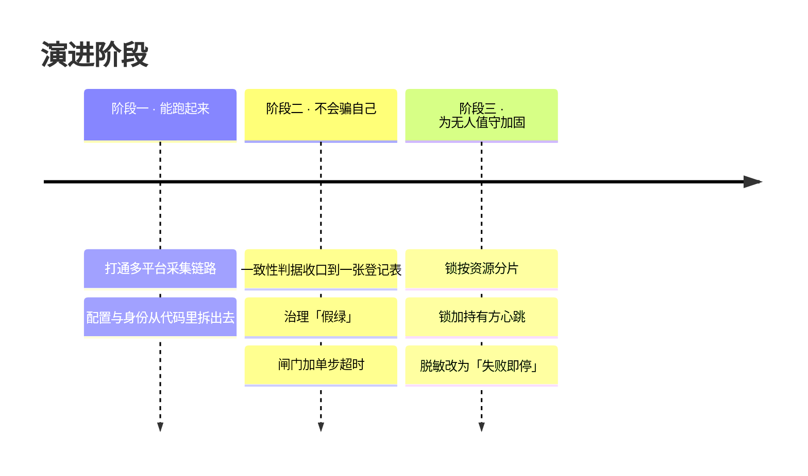

# 工程时间线

> 这套系统从「能跑」到「无人值守可托管」的过程。  
> **只列工程节点**：每个节点写清「遇到什么问题、怎么解、学到什么」，不含任何业务细节。
>
> 完整工作记录另有脱敏存档（含逐日细节），面试时可提供。

---

## 本页速览

| 阶段              | 主题             | 代表节点             |
| --------------- | -------------- | ---------------- |
| **一 · 能跑起来**    | 打通链路、配置与身份外置   | 断点续跑、身份判据、提交前自查  |
| **二 · 不会骗自己**   | 判据收口到一处、治理「假绿」 | 登记表驱动、警告要显形、单步超时 |
| **三 · 为无人值守加固** | 并发与数据安全        | 分片锁、心跳、脱敏失败即停    |

下面 12 个节点逐条写「遇到什么问题 / 怎么解 / 学到什么」。

---

## 现状（诚实版）

### 花了多少

| 阶段        | 跨度                           | 强度                                      |
| --------- | ---------------------------- | --------------------------------------- |
| **一 + 二** | **10 天**（2026-10-07 ~ 10-16） | 每天 **16 小时以上**高强度看守 + 引导，**另加睡眠时段的自迭代** |
| **三**     | **进行中**                      | 见下节「走到哪了」                               |

**折算成投入**：10 天 × 16 小时 ≈ **160 人时** —— 这大约等于**一个正常工作月**的人时。

> ★ 所以准确的说法不是"用时很短"，而是**日历被压缩了**：  
> 人时投入一点没少，只是把一个月的工作塞进了十天。  
> **快的是日历，不是人。**

> ⚠ 数字更正：初稿写的是"**半个月**"，但它与记录不符 ——  
> git 首次提交是 **2026-10-07**，工作日志从 **2026-10-08** 起连续覆盖，  
> 两份独立记录都指向 **10 天**。所以这里写 **10 天**，因为它**可核实**；  
> 「半个月」没有记录支撑，已经撤掉。

---

### 做到哪了

| 写入类型                    | 状态                  | 为什么是这个状态                             |
| ----------------------- | ------------------- | ------------------------------------ |
| **只读型任务**（读取 → 解读 → 产出） | ✅ **无人值守在跑**       | 这类任务**没有副作用** —— 出错最多是产出不对，不会造成不可逆后果 |
| **技术面写入**（改代码 / 改文档 / 推分支 / 记忆蒸馏）      | ✅ **无人值守在跑** | ★ **夜间自迭代**：每小时一轮、到早 8 点，连续多夜 —— 期间真的改了代码、改了文档、推了分支    |

> ★ 这条界线**不是按"有没有副作用"划的**（技术面写入一样有副作用），
> 而是按**"后果能不能自己兜住"**划的：技术面写入有版本控制、错了能回滚；
> 业务面写入直接影响钱，**错一次就收不回来**。  
> **「能跑」和「敢让它自己跑」是两件事** —— 中间隔着的是"出错了能不能退回来"。
>
> ⚠ 但**这条界线只对业务面那一层成立**。技术面的写入（改代码 / 改文档 / 推分支 / 记忆蒸馏）
> **早就在无人值守下跑了**：夜间自迭代每小时一轮、连续多夜，期间真的改了文件、推了分支。
> 业务面没落地，**不是技术不行，是业务上不方便试**。
>
> ⚠ 另更正一句初稿：原来写的是"写入型任务只有技术实现、没有落地"，
> 那是把**技术面的写入**也一起否掉了 —— 两件事必须分开说。
>
> ⇒ 这也解释了第三阶段为什么叫「**为**无人值守加固」而不是「无人值守」：  
> 加固的是**业务面那一层**写入 —— 技术面已经在跑了。

---

### ★ 「无人值守还敢让它写」凭什么成立

不等于"没出过事，就当它没事"。**是因为两道防线都有记录**：

| 防线 | 机制 | 日志里的实际记录 |
|---|---|---|
| **主动克制** | 无人值守时无法请示 ⇒ **高危操作一律不跑**，改成「换新路径 / 归档到带时间戳目录 / 跳过并记待办」 | 多次「**有意未做**」：关键脚本未动、口径不明的计数未改、删目录改为归档 |
| **硬拦截** | 内建检查器**真跑** | ★ **至少 4 次被自己的自检拦下** —— 脱敏漏了一处、凭空造出一条"假红"、写错的路径、README 里的举例被当成真链接 |

> 关键区别：**不是"AI 很自觉"，是"想越界也过不去"。**
> 「**关键脚本 + 无人值守 ⇒ 只发现不动**」这条纪律，就是被那些拦截喂出来的。
>
> ⇒ 这条经验可以直接复用：**放手的程度，等于防线被抓现行的次数。**

---

## 三个阶段

---

## 节点明细

| #  | 阶段 | 遇到的问题                                        | 怎么解                                              | 学到什么                           |
| -- | -- | -------------------------------------------- | ------------------------------------------------ | ------------------------------ |
| 1  | 一  | 采集流程跑一次能成，**再跑一次就乱**（重复执行、状态残留）              | 拆成可记录进度的若干步（编排）＋ **断电可续**（记住做到哪）＋ **重跑无副作用**（幂等） | 「跑通一次」和「能反复跑」是两件事              |
| 2  | 一  | 敏感配置与代码混在一起，改个配置要动代码                         | 配置拆到独立文件；身份**改为看平台上的既成事实**，而不是看自己填的标记            | 判断依据不该用「自己能随便改的东西」             |
| 3  | 一  | 本机绝对路径、个人身份、真实业务值，可能被顺手带进仓库                  | 提交前自动扫描三类东西：占位符有没有漏替、远端地址、绝对路径                   | **提交前自查**比事后清理便宜一个数量级          |
| 4  | 二  | 同一条判据**写在两个地方**，改一处漏一处 ⇒ 检查悄悄少跑一项            | 收口到**一处**（一张 JSON 登记表）；加一项检查只改这一处                | 同一个判断有两份，就一定会漂移，而且是**静默**漂移    |
| 5  | 二  | 程序退出码是 0，就被当成「全绿」；真实缺陷**以"可以推送"的形式蒙混过关**     | 判定行不再无条件打 ✅，把**警告条数**摆到眼前                        | 「没有阻塞项」≠「没有问题」                 |
| 6  | 二  | 判据从写死在代码里，改成放在配置表里之后，**原来"检查根本不会挂"的隐含保护没了**  | 给每次调用加单步超时；**超时 = 阻塞**                           | 抽象化会顺手移除隐含保护，要**显式补回来**        |
| 7  | 二  | 检查器「没跑成」有可能被当成「跑通了」                          | 三种情况**一律阻塞**：判断不了 / 没声明严重级别 / 登记表读不出             | 「判不了」必须和「不通过」同等待遇              |
| 8  | 三  | 不相干的任务，被同一把全局锁逼着排队                           | 先盘点**实际共享**的资源，锁**按资源分片**                        | 锁的粒度该由**资源**决定，不是由「任务」决定       |
| 9  | 三  | 任务早就做完了、进程还留着 ⇒ 锁被白白占着，直到**超时阈值**耗尽          | 持锁方定期**打卡**；等待方看到打卡过期，即可接管                       | 「进程活着」≠「在干活」                   |
| 10 | 三  | 脱敏只替换一次，漏了一处却看起来干净                           | 替换后**独立再扫一遍**，有残留就拒绝产出                           | **验证必须独立于被测对象** —— 自己检查自己等于没检查 |
| 11 | 三  | 词典只覆盖「已知的」真实业务值（客户编号、公司名这类），文档却可能引用**别的**同类值 | 补一条兜底规则：**数字形态 + 上下文关键词**同时命中 ⇒ 一样替换             | 靠枚举的防护一定有缺口，要留兜底               |
| 12 | 三  | 单机上的锁，在多机环境里失效                               | （进行中）评估带超时的分布式租约 —— 让多台机器之间也能安全抢锁                | 单机上的做法，不要硬撑分布式场景               |

---

## 一个具体的教训（值得单独记）

抽离代码时踩到的**跨平台坑**。

**要解决的事**：怎么判断某个进程是不是还活着 —— 用来回收被僵尸进程占住的锁。

|                | 写法                     | 结果                                     |
| -------------- | ---------------------- | -------------------------------------- |
| **原实现**（Node）  | `process.kill(pid, 0)` | ✅ **安全** —— 传 `0` 表示「只探测存不存在，**不发信号**」 |
| **照搬到 Python** | `os.kill(pid, 0)`      | ❌ **在 Windows 上，会把那个进程真的杀掉**           |

原因：Python 的 `os.kill` 只对 `CTRL_*`（Ctrl+C 那一类控制信号）有特殊语义，  
**其余的值 —— 包括 `0` —— 一律走「强制终止」这条路径**。

**结论**：跨语言移植时，**同名的 API ≠ 同义的 API**。安全相关的调用必须逐条查文档。

> 这就是 `reslock` 里那个「判断进程死没死」的函数（`pid_alive`）为什么绕开 `os.kill`，  
> 改用 Windows 的 `OpenProcess` + `GetExitCodeProcess` ——  
> 这两个系统接口**只查询状态，不发任何信号**，所以绝对不会误杀。

---

## 每条工程判断的落点

上表那些判断，没有停在文档里，都落成了**可执行的检查或库**：

| 判断           | 落点                                                              |
| ------------ | --------------------------------------------------------------- |
| 提交前自查        | 通用化扫描 + [`checkgate`](../zeroagent/checkgate.py)（**发布前的检查闸门**）  |
| 判据只写一处       | 登记表驱动的闸门 —— 加一项检查只改登记表                                          |
| 「判不了」≠「通过」   | [`checkgate`](../zeroagent/checkgate.py) 的四条 fail-closed 规则     |
| 验证独立于被测对象    | [`redact.residual`](../zeroagent/redact.py)（**脱敏后独立再扫一遍**的那个函数） |
| 「进程活着」≠「在干活」 | [`reslock`](../zeroagent/reslock.py) 的**持锁方打卡**（心跳）             |
