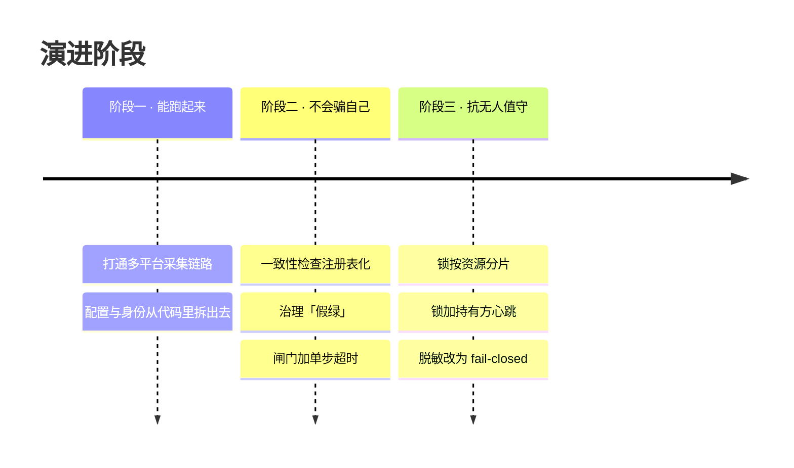

# 工程时间线

> 这套系统从「能跑」到「无人值守可托管」的过程。
> **只列工程节点**：每个节点写清「撞到什么、怎么解、学到什么」，不含任何业务细节。
>
> 完整工作记录另有脱敏存档（含逐日细节），面试时可提供。

---

## 三个阶段

---

## 节点明细

| # | 阶段 | 撞到的问题 | 做法 | 学到什么 |
|---|---|---|---|---|
| 1 | 一 | 多平台采集跑一次成功、复跑就乱 | 任务编排 + 断点续跑 + 幂等 | 「跑通一次」和「能反复跑」是两件事 |
| 2 | 一 | 敏感配置与代码混在一起，改配置要动代码 | 配置外置；身份改为依赖**平台事实**判定 | 判据不该用「自己能改的东西」 |
| 3 | 一 | 本机绝对路径 / 个人坐标 / 真值可能被带进仓库 | 提交前通用化扫描（占位符、远端、路径） | **提交前自查**比事后清理便宜一个数量级 |
| 4 | 二 | 一致性判据**散落两处**，改一处漏一处 ⇒ 静默少跑 | 收口到**单一真源**注册表；加一项只改一处 | 同一判断有两份，就一定会漂移，而且是**静默**漂移 |
| 5 | 二 | 退出码 0 被当成「全绿」，真缺陷以「能推」的形式过去 | 判定行不再无条件打 ✅，把**警告条数**摆到眼前 | 「没有阻塞项」≠「没有问题」 |
| 6 | 二 | 判据数据化后，**原来"检查都不会挂"的隐含保护没了** | 给每次调用加单步超时；**超时按阻塞** | 抽象化会移除隐含保护，要**显式补回** |
| 7 | 二 | 检查器「没跑成」可能被当成「跑通了」 | 判不了 / 未声明 / 注册表坏，**一律阻塞** | 「判不了」必须和「不通过」同等待遇 |
| 8 | 三 | 不相干的任务被同一把全局锁逼着排队 | 盘点实际共享资源，锁**按资源分片** | 锁的粒度该由**资源**决定，不是由"任务"决定 |
| 9 | 三 | 任务早干完了、进程还留着 ⇒ 锁**白占满 TTL** | 持有方定期**心跳**；等待方见心跳过期即可接管 | 「进程活着」≠「在干活」 |
| 10 | 三 | 脱敏只替换一次，漏了一处却看起来干净 | 替换后**独立再扫一遍**，有残留就拒绝产出 | **验证必须独立于被测对象**——自己检查自己等于没检查 |
| 11 | 三 | 词典只覆盖「已知」真值，文档可能引用**别的**同类值 | 补上下文兜底规则（关键词 + 形态） | 枚举式的防护一定有缺口，要留兜底 |
| 12 | 三 | 单机锁在多机下失效 | （进行中）评估带过期的分布式租约 | 单机原语不要硬撑分布式场景 |

---

## 一个具体的教训（值得单独记）

抽离代码时踩到的跨平台坑：

> 原实现是 Node，用 `process.kill(pid, 0)` 判进程存活——**安全**（只探测存在性）。
> 照搬到 Python 写成 `os.kill(pid, 0)` —— **在 Windows 上会把那个进程真的杀掉**：
> Python 的 `os.kill` 对非 `CTRL_*` 信号一律走 `TerminateProcess`，`0` 也不例外。

**结论**：跨语言移植时，**同名的 API 不等于同义的 API**。安全相关的调用必须逐条查文档。
这也正是 [`reslock.pid_alive`](../failclosed/reslock.py) 里那段 `OpenProcess` 的由来。

---

## 每条工程判断的落点

上表的判断没有停在文档里，都落成了**可执行的检查或库**：

| 判断 | 落点 |
|---|---|
| 提交前自查 | 通用化扫描 + `checkgate` |
| 单一真源 | 注册表驱动的闸门 |
| 判不了 ≠ 通过 | `checkgate` 的 fail-closed 四条 |
| 验证独立于被测对象 | `redact.residual` |
| 进程活着 ≠ 在干活 | `reslock` 心跳 |
